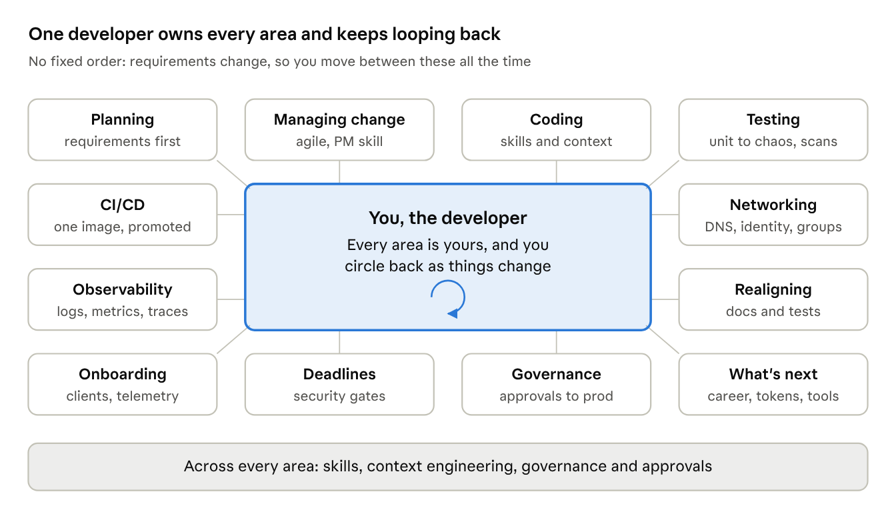

*The views here are my own and don't represent my employer.*

[Download the white paper (PDF)](/assets/papers/developing-at-enterprise-scale.pdf)

## Executive summary

This paper shows what it really looks like to be a developer inside a large enterprise in the age of AI, right now. Not the demo version. The version where you own a project from the first requirement to the last production change, inside a company that's built for safety and scale, not for agents.

The tagline I keep coming back to is that everyone is a developer now. If you're not a developer and you aren't using AI, you're already behind. If you were a developer before AI and haven't adopted it, you may be behind too. That's the hook. The point is what the work actually looks like day to day.

I've worked as a solo developer and on teams of very different sizes, on very different projects. They all end up the same way: I'm responsible for every facet of the project. In this paper I walk through that whole lifecycle from the seat of a senior developer, starting the moment someone hands you an idea and ending in production and beyond.

My own company is a fair middle case. It's ahead of the game compared with large enterprises that have been big for a long time, and most likely behind the tech startups. So this isn't a complaint about one company. It's what the job realistically looks like when you can move fast and the organization around you has good reasons to be careful.

The short version is that AI lets one person move very fast inside a company that moves more carefully. That speed doesn't come from typing code faster. It comes from planning harder, codifying what your company expects into skills your whole team shares, engineering the context your agents work from, and spending tokens up front so you don't spend far more of them later.

The friction is just as real. Governance, security gates, identity, networking and change windows don't go away, and they shouldn't: they protect customers, data and the business. But right now they can slow you down as much as AI speeds you up. Holding both of those truths at once is what being a developer looks like in 2026.

### Who this is for

I'm writing this for someone who wants a software job or is curious about one. It's also for people who already have a software job and want to know what top talent thinks about when starting new projects, and how things really work at a big company.

A lot of people don't know what coders do now that AI helps. They think it's all AI. It's not. And if you're a developer outside a big company, you can skip many of these steps; a lot of them exist because of enterprise scale.

### The job at a glance

<figure>
  
  <figcaption>The twelve areas this paper covers. You move between them and loop back as things change, with skills, context engineering and governance running through all of them.</figcaption>
</figure>

## The fast developer at the slow company

Picture a senior developer at a large enterprise. The company is trying to move fast, and for its size it does, but it still moves slower than you can. You, with AI at your side, are in a unique position to move really fast inside it. That gap between your speed and the company's speed shapes almost everything in this paper.

I'm starting from a simple assumption: there's already an idea, or someone has created a project and handed it to you. You didn't pick the problem. Now it's yours, from the first requirement to the last production change.

And it really is all yours. Over the life of one project you'll be the developer, the architect, the project manager, the DevOps engineer, the tester and the site reliability engineer. There's no one person who should just be doing one thing anymore. AI is what makes that possible, and it's also what makes it expected.

Here are the areas I'll walk through. They're roughly in the order you'll first run into them, but this is agile, not waterfall, so you'll loop back through most of them more than once:

1. Planning and requirements
2. Managing change, because this is agile and not waterfall
3. Coding with skills, plugins and connectors
4. Testing
5. Environments and CI/CD
6. Observability
7. Enterprise networking and identity
8. Realigning your docs and tests with reality
9. Onboarding clients and listening to telemetry
10. Deadlines and security gates
11. Governance and life in production
12. What comes after: your career, your token budget and your tools

### Know where you are on the AI fluency spectrum

AI fluency is a spectrum, and it's important to know where you are on it. Most people at an enterprise are still making their first vibe-coded HTML pages or slides. That's a fine place to start, but it's only the start.

Don't be the person who presents a "cool" AI-generated HTML report, sends it to the whole org, and explains that if AI could do this, everyone should be able to. If you can't recognize slop, you aren't experienced enough with AI yet.

## 1. Planning and requirements

It all starts with the plan. Once you have your project idea, you hopefully have a set of requirements. There's a really good chance you don't, so you'll be working with a team of people to create them.

### Documents first, and they live where your company keeps them

You may want a product requirements document, a business requirements document and an architecture diagram. It's not that simple at a big company, because things work in specific ways there. You'll need to leverage skills, plugins and connectors to do it right.

The material you need is scattered. Some of it sits in Confluence or a wiki, some in SharePoint, some in databases you have to request access to. Some of those places your AI can reach and some it can't, and you need to know which before you count on it.

### Architecture diagrams from approved patterns

You can't just draw any architecture diagram. You need to follow your company's approved patterns. My approach is to turn those patterns, which are often draw.io files as well as Markdown templates, into a skill. The AI then uses the skill to produce a diagram that fits my project.

Often you need more than one: a technical diagram and an overview diagram, because different teams ask for different things. You don't want to recreate these by hand every time, which is exactly why it belongs in a skill.

### Requirements are the hardest part

This is the trickiest part of working fast at a slow company. People don't understand how robust requirements need to be in the age of AI, and they don't really know how to get there. Whether you use Jira or GitHub Issues, your job is to discover every gap you can.

This is where it's really powerful to be someone who understands the business, understands the domain and understands the technical side of the solution. You might have a skill that breaks everything you know, and every source you can reach, into features, epics, user stories, requirements and acceptance criteria. Use whatever structure you and your team or company decide is best. Either way, it comes down to you.

You need to know what the user expects. You need to know your SLAs and your SLOs. These aren't hypotheticals; they're hard caps. If there's conditional logic in a requirement, like "if this is possible, then do that," figure it out before you build, not during.

Think about who will use what you build, too. Every site or app today should be designed for how humans will interact with it and how agents will interact with it, not just one or the other.

### Check the artifact repository before you write a line

If your project depends on specific packages, you'd better know how your company's artifact repository works, whether that's JFrog Artifactory or something else. Check it to confirm your literal technical requirements are actually available.

Here's how that goes wrong. Say your requirements call for a specific version of a library or runtime. You plan around it, design around it and start coding. Then you find out that version isn't in Artifactory. Now you have to use a different version, or a different tool, and it doesn't do the thing you planned on. Work you've already done has to change. The later you catch it, the more it costs.

That's why it's important to have skills that check what's available, and what's newest, in Artifactory, and to know how to check yourself. And if you need something that isn't there, know how to request it. That can mean a software approval for the package, license or software, and approvals take time, so start early.

### Get your team on the same page

The same goes for the people on your team. Get on the same page about what they're comfortable with. If they're not comfortable with the thing you want to use, work it out now.

Containerize as much as possible, with Docker Desktop or Podman. Put everything in a container.

Codify everything else too. Use Terraform for your infrastructure as code, or Helm if you're leveraging Kubernetes. When your containers, infrastructure and configuration are all code, they're easy to parameterize per environment and easy to run through your pipelines.

Don't write your automation as Mac-only scripts, bash scripts or PowerShell scripts. Use something operating-system agnostic. That usually means Python: it runs on Windows and Mac, and AI is really good at writing it. If you have stricter performance requirements, you might choose something else; it depends on what you're building.

The point is to make your work friendly to everyone around you. You don't want to be the only one who can work on it, and you don't want to ship things that don't work on other people's computers.

## 2. Managing change: this is agile, not waterfall

Now you're done with planning. Probably. Maybe. Hopefully. But this isn't waterfall; we don't work in waterfall anymore. Even a software factory tends to push you back toward waterfall, and that just doesn't really work. I've tried it. Requirements change all the time, and things get really messy.

So make sure you have a skill that helps manage the project, a skill that acts as a project manager. Honestly, you'd love an actual project manager who knows how to use that skill. You don't want to be the developer who has to solve all of it.

If you are in that position, it's still possible. It's just a lot more work. Every time a new requirement arrives, because someone changed their mind or because I realized something I hadn't before (which is bound to happen), I don't want to stop and work out what I now have to do before I can do it. I just want to do what I'm told. Life isn't that easy, and that's the truth. A good project-management skill is how you close some of that gap.

## 3. Coding with skills, plugins and connectors

Now you start coding. You have your requirements, your plans and your design docs. To stay on the same page as everyone else, and to work the way a large company works, you should be using skills, plugins and connectors here too, not just in planning.

### Capability skills and enterprise preference skills

I break skills into two kinds. Capability skills teach your agent how to do something. Preference skills teach it how things are done at your company: the things anyone working there simply has to know.

The proxy is a big example. Large companies need very secure environments, so you have to understand how the network is configured and what you need to do on your side to integrate with it correctly. That might mean creating private links or DNS entries. You'd want skills for all of that.

### Share skills across every harness with a package manager

Those skills also need to work across different harnesses, IDEs and agents. That takes something standardized. Microsoft's Agent Package Manager (APM) is really good for this. APM supports multiple clients, so even if your team uses different harnesses and tools, everyone gets the same experience. Another really good thing about it is that you can pull from other people's marketplaces and registries, not just your own.

You could keep a local APM repo, and that does work, but your company can't track it. You probably want a private enterprise repo instead, set up however your company mandates. Your company is likely trying to look at everything you do and learn from it: how you use AI, how the company is leveraging AI, whether you're good at coding and at getting work done. If they want that, you listen and work with it. The upside is that you can share exactly what your team needs.

### Structure your repos early

Now you're working across several repositories: the APM repo, your application repo, and maybe an infrastructure repo. Maybe you have a DevOps person. That's an extremely important role on a project. If you don't know DevOps, either leverage skills for it or find someone who does. At some point you'll be all of these roles, but you can't always start from zero (even though sometimes you have to).

I also like one repo that contains all the others, a kind of context repo, whatever people call it. I use Git submodules for this, which gets a little messy with the submodule pointers.

Your documentation changes all the time, so automate keeping it current. You can let your agent manage it locally while you work, or run dedicated clean-up sessions. Another strategy is to use GitHub Actions or Azure DevOps pipelines with cloud agents, such as GitHub Copilot's cloud agent, to read your current code and update the docs, perhaps on every change to your main branch. This gets messy fast, so set up the structure early, so that your workflow scales with your skills and your codebase.

### Context engineering is the most important thing

Think about your hosting before you build. Maybe you're on Azure, AWS or Google Cloud. Maybe you're on-premises, or hybrid. You want skills, or at least a connection to the right documentation, for whichever it is.

Your agents are super smart, but you can waste a lot of time by not spending the extra tokens to give them the extra context. With it, the agent can get things done the first time and the right way. It's still a bit of a luck of the draw. But context engineering is on your side, and it's the most important thing for getting all of this done.

By now you have your skills and your repos, your whole team can use them, and it's all containerized. Now you're really coding.

### The biggest thing: let your AI verify its own work

Giving your AI the ability to verify is the biggest thing. For a UI, that might be Playwright or Puppeteer, so the agent can open the app and see what it built. For almost anything, it's telemetry. Whatever it is, the AI should be able to get the context it needs, when it needs it, and check its own work instead of guessing.

That's where progressive disclosure comes in. Instead of loading everything into context up front, you give the agent a short map and let it pull in the detail it needs as it goes. It's one of the context-engineering techniques every worker in the age of AI needs to understand, not just developers.

### Make your agent's answers readable by humans

Make sure that when your AI responds to you or to others, it doesn't just cite requirement IDs, or IDs in general. It should make things digestible without all the references. I don't want to click on links just to understand what my agent is trying to tell me.

This is one way to bridge the gap between an effective project structure and the humans who are still part of the development process. Most enterprise work hasn't reached human-out-of-the-loop yet. So we need to understand what's happening most of the time, even those of us who trust AI more than others do.

## 4. Testing

When you're building an application, you need to think about testing. Early on, though, you may not want to think about it too much. You'd just be creating more things you have to go back and change as the application matures, and early on you're only about halfway there.

### Right-size it early, and parameterize everything

Write the essential tests while you work. Maybe you practice test-driven development; that's up to you. Don't overdo it, but do make sure your tests are parameterized and scalable, and that you can run them locally.

Parameterization is what lets you move from environment to environment. At an enterprise you might have two environments or three: dev, stage and prod, or a dedicated test environment. You might need simulated clients too. If you're building the server and client VMs will connect to it, you want to test exactly how that's going to work.

### Enterprise scans and automated reviews

You also need the scans enterprises run, whether that's SonarQube, CodeQL or the many others I could name. You're testing for code smells, for linting (with tools like Ruff), for all of it, so that you know you're writing good code.

Over time you might add automated GitHub Copilot reviews on every commit, push or pull request into main. Set it up how you like. Companies care a lot more about security now than they used to.

### Testing means the whole range

When I say testing, I don't just mean unit tests. I mean unit, end-to-end, integration, penetration, load and chaos testing, and more. What you need depends on your language and the kind of application you're building.

Your agents can now spin up isolated containers, act as an adversary and try to break in. Use strategies like that to prove your product meets the requirements you set at the beginning, or the ones you discovered along the way. Maybe you learned you need a guaranteed P99 latency, or that the application must stay up 99.9999% of the time. The only way to really know is to test for all of it, including the cases your agent thinks of that you forgot to expect.

So even though you're "just" a software developer, you're also the tester. You're the site reliability engineer, the DevOps engineer and the project manager. You're all of these things.

## 5. Environments and CI/CD

Let's say you've used every skill and tool you have to build the application. You've done the easy part, maybe 80% of what it really takes.

### Show it early and fail fast

Now you need to show it to your clients. This is a fail-fast environment: if you aren't failing fast and showing people what you have, you'll wear your clients out. Showing them early lets them guide you while you build. That's why it's agile.

You start making real progress. The application seems close to ready in a dev environment. Then you need to move it to a higher environment. Maybe you set that up early, maybe you didn't, and either way it takes a lot of work.

### Read your stakeholders

When you show your work, learn to tell your stakeholders apart. Some are perfectionists. Others are there to solve a problem and care far more about whether it works. Some value things more when they feel authentic, and some like them more when they look cool.

Many people can now tell when something was AI-generated, or even when it was tweaked after AI generated it. I'm not the perfectionist here myself, but knowing your audience mattered before AI and it will keep mattering.

### Connect your agent to the real environment

Make sure your agent has CLIs, APIs and MCP servers that connect to the actual environment. They bridge the gap between what your application does and what that environment needs.

### A promote workflow, never a shortcut to prod

You need CI/CD. The flow I aim for looks like this:

1. Pass CI locally.
2. Push your branch and open a pull request, which runs the automated checks.
3. Pass CI on the pull request.
4. Build one image and push it to your artifact repository, such as Artifactory.
5. Let your pipelines pull that same image and deploy it to the right environment.
6. Promote it from environment to environment. You never pull directly into prod.

You have to think through all of this just to get your application into the environment you want, safely and in the right order.

### Build yourself a diagnostic panel

It's really helpful to build diagnostic panels that only admins can see. They tell you which environment you're in, how it's performing and anything else you need at a glance.

## 6. Observability

It's really important to capture logs, metrics and traces, and maybe more. You need all three, and you need them correlated through traces, so that you know what happened whenever anyone does anything. If there's an issue, you find it.

One way to do this is Prometheus, Loki and Tempo to capture metrics, logs and traces, with Grafana to show them in dashboards. The dashboards are mostly for you. Your agent can query Prometheus directly, which is super useful. That's just one stack; many other providers can give you logs, metrics and traces.

Observability lines up with your testing. It also enables a kind of interactive testing, where your agent uses the application, looks at all the telemetry and confirms it works.

### Decide where telemetry lives and for how long

You also need to decide how long you keep telemetry and where. Is it in Azure Storage? A Log Analytics workspace? Is this a SOX application? If it is, you're required to retain it for 13 months. These are the things you actually have to think about in an enterprise setting.

## 7. Enterprise networking and identity

Then there's everything that makes enterprise infrastructure enterprise: private endpoints, DNS records, corporate DNS versus private DNS, and the SLOs and wait times on every request you make to other teams. How do those requests get approved? Do you approve them yourself? Do other admins have to? Are any of the approvals automated?

Maybe this is all captured in skills, because someone at your company did a good job and wrote it down. Or maybe you have to figure it out on your own. If you do, don't keep it to yourself. Share it.

### Identity is where automation meets the wall

Identity bites hardest when you start onboarding people. Say you need groups for access. You could create them yourself from the command line, but that's not really good enough. You're supposed to use an internal application your company built to make group creation easier.

Except you can't automate that application, unless you use Playwright. Then you need an interactive sign-in, because everything goes through the company's single sign-on. That's deliberately hard to automate, because your company isn't built for agents. It's built for safety and enterprise scale. So you either figure out how to automate it with Playwright, or you go create the groups by hand.

Then a new platform arrives that manages all the groups. Even if you made it through the old process, now you have to onboard to the new one. Maybe the team behind it has to create the groups for you.

### Decide what you want to own

This raises a question you have to answer deliberately: do I create and manage these things, or does the client? Think about the lifetime of the project. As it scales out, do you want to be responsible for all these little things, or should they be someone else's responsibility?

## 8. Realigning docs and tests with reality

If you got this far, you're probably pretty far into your project. You probably think the application is pretty good. There might be a few bugs; you might know what they are, or you might not.

You've also noticed that you have an insane amount of tests and an insane amount of documentation. Once again, you need to go back and update a lot of it to match the current reality of the project, because the project has shifted in big ways. Everything needs to be aligned.

As much as you don't want to spend tokens, and as much as you want to stretch your company's token allocation, this step is essential. Please do it. The more out of date and misaligned your context is, the worse time you'll have, and the more tokens you'll spend later. Spend them up front.

## 9. Onboarding clients and listening to telemetry

Now people are onboarded, and you're relying on telemetry to see how they're doing. Some feedback comes in: this looks good, this doesn't work, this throws an error we don't catch.

Better still, you catch some of that yourself before anyone tells you, because you set up the right telemetry. It's never going to be perfect, but it gives you a real shot.

## 10. Tight deadlines and noisy security gates

Now you're trying to meet deadlines that are tight, sometimes tighter than they should be. That's partly because the company expects AI to let fewer people move faster, and in a lot of ways it does. What hasn't caught up yet is an understanding of what all the extra checks cost.

The more security checks you face and the more skills you're handed, the more they partially help and partially hurt. If the skills aren't really high quality, they slow you down. You might be ten times as productive, maybe a hundred times, and still be going back to change things constantly.

One change triggers one minor code smell. That means I redo my tests. I thought I was about to push good code through my pipeline, and instead I'm redoing all of it. Meanwhile, reports flag you as red and tell you to turn green, to be more secure or to attest that you did something, without giving you exact instructions or a skill for how.

None of these checks is unreasonable on its own; most exist because something went wrong somewhere before. But until they're codified into high-quality skills, blueprints and best practices, everything stays messy.

How you build those skills matters too. Making them dynamic, so they reference your docs instead of copying them, means fewer things to update when a doc changes. But if a doc moves, you have more to change. That's why upfront structure and planning are essential: they make things change less often. Usually more dynamic is the right answer, but too many references can get annoying.

Skills also need to be maintained. Tools change all the time at big companies, and communication about those changes is pretty poor. A skill that was right when you wrote it may not be right today.

## 11. Governance and life in production

You're finally there. You have a good application with real reliability engineering behind it, and you're ready to move to production. Maybe you went through pre-production first, running in the production environment with real people in it but not technically in production yet.

### The governance gauntlet

Now you have to make sure you went through governance correctly. If you're building an AI product, governance might be fast-tracked when a senior leader is sponsoring it. Or you might wait six months or longer, because the reviews are thorough and a request passes through a lot of hands.

The checklist before you can even build is long. Typically it includes:

- Governance approvals for each stage of the app, from a build approval through an operating approval
- The enterprise licenses you need
- Software approvals for the additional packages, licenses or software you want to use
- SOX approval, which is rigorous, as it should be
- AI approval
- Subscription approval, then onboarding to that subscription

Then, to actually go to production, you submit to governance again, so everyone knows how you work and can confirm you pass all the checks.

And that's not all. You also have to do app creation so a budget can be tied to your application. That's partly politics, different ways to split the imaginary dollar, and partly how a company this size keeps track of where its money goes. You have to pick a production release date before you even start the project, too. The business needs a date to plan around, so you're forced to guess, and in my experience the first guess is almost always wrong. That's why expectations kill: set them carefully and update them early. Depending on the project and its requirements, you may need firewall requests and network exceptions as well. There's more, but you get the gist: approvals upon approvals, each one there to manage a real risk.

### Production is a new set of constraints

OK, great, you're in production. Now you monitor everything and figure out how to safely get new code in. You'll probably need a change request for anything that touches production. Then you hit a window where the company says no changes in production. So what do you do?

New vulnerabilities show up too. Your checks now catch them, and they come far more often, because you're checking far more things. You're safer, but you're moving slower. That's just how things work right now. It will get better over time, but there are a lot of rough patches today.

## 12. What comes after: career, cost and converging tools

### Your next project is bigger

Then you finally finish. Maybe this is your life's project and you stay on it for years. More often, people who are good at figuring all of this out get a new assignment: "Go do what you did over there, over here." They keep getting new and bigger opportunities.

So you work your way up, one project after another. Along the way you might do only some of these steps, but you take on more and more responsibility. You stop being a solo developer and start leading a team. At some point you start having your own ideas and following through on your own projects, assigning people to them instead of only developing someone else's idea.

The more you work, the more people notice, and the more you move up. But it's tough. You have to move really fast, and not everyone wants to speed up with you. Some would rather you slow down and be safer, and they have a point, but the pace isn't going back.

### Tokens are a balancing act

More tokens means more compute, and more compute means more productivity. Intelligence keeps getting smarter, and it keeps getting cheaper. So it's a balancing act.

You want to move fast, fast, fast. Think of it as a spectrum: agent swarms, a few agents in parallel, one agent at a time, or no agents at all. The further toward swarms I go at my company, the faster I'd run out of tokens. I'd be more productive, but I'd also be more wasteful. When a deliverable is about to miss its deadline, maybe I'd have to spend like that. Even then, a swarm usually isn't the safe choice in an enterprise setting. But it cuts both ways: the more productive and efficient you are with your tokens, the more tokens you may be given.

Tokens won't be an issue once model orchestrators get good enough. They're just starting to get decent, so hopefully that happens soon.

Until then, if you need to meet an important deadline, go all out. Prove you can do good work and move fast, and don't worry too much about the tokens. But have KPIs ready to prove you deserve more resources. If you're a developer, that could be your Git history. It could be demos, or many other kinds of evidence. Maybe your company tracks this for you; maybe you need to track it yourself.

### The tools and the terms are converging

By the time I finish a project like this, I blink and my company has all these new tools I can use. They're all basically the same and interchangeable: different providers offering the same products. To be honest, Anthropic tends to come up with the good ideas and implement them first, and then the other companies see them and copy them.

The same goes for the vocabulary. AI agent, super agent, orchestration agent, superintelligence, plain old AI: the meanings behind most of these new terms are mostly the same. People just love creating new names. That's another thing that will always be true at big companies: new acronyms and new terms for the same thing.

## Looking ahead to 2027

That's the life of a developer inside an enterprise in 2026. 2027 will probably look very similar. I can't see further out than that.

We'll probably have software factories set up by then, where the person with the idea gets the money. And there will still be people who aren't good at using AI to code, because they're worried about it. They are often good at catching bad decisions, though, and they're good people to have around. You just don't want them right next to you while you build. You want them on the requirements side.

## Conclusion

That's what it really looks like to be a developer inside an enterprise right now. Everyone may be a developer now, but inside a big company the developer's job is every job on the project. AI makes one person fast enough to carry an idea from requirements to production. The company around that person is still slower than a startup, and it's slow for real reasons: security, compliance, identity and governance.

The developers who do well in this era don't fight that. They plan harder up front, codify what their company expects into skills their whole team shares, engineer the context their agents need, and spend tokens early so they don't waste them later. Then, when they figure something out, they share it.
